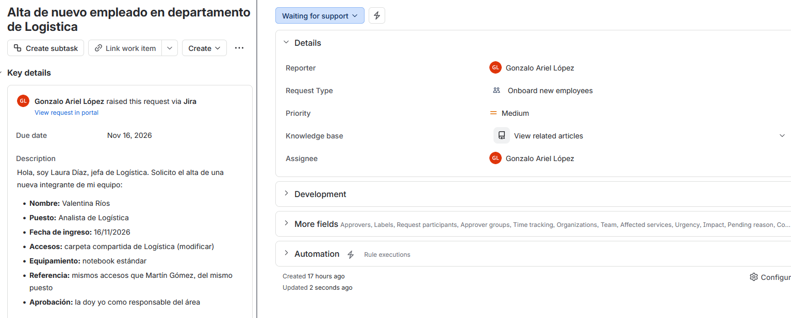
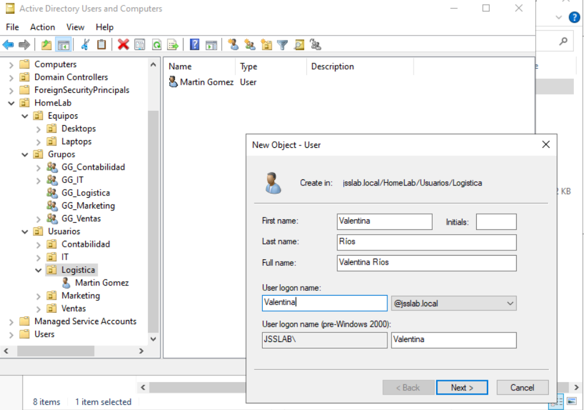
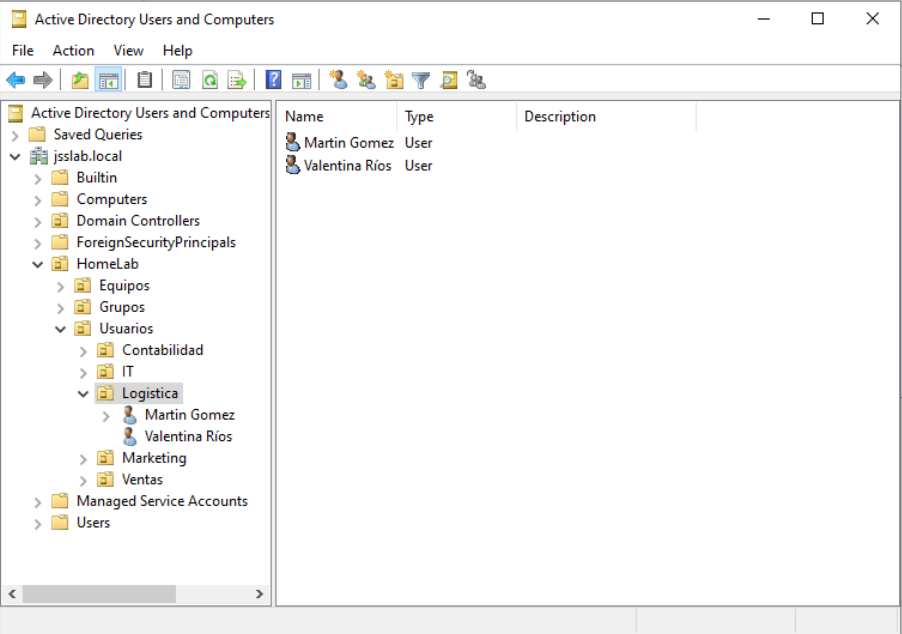
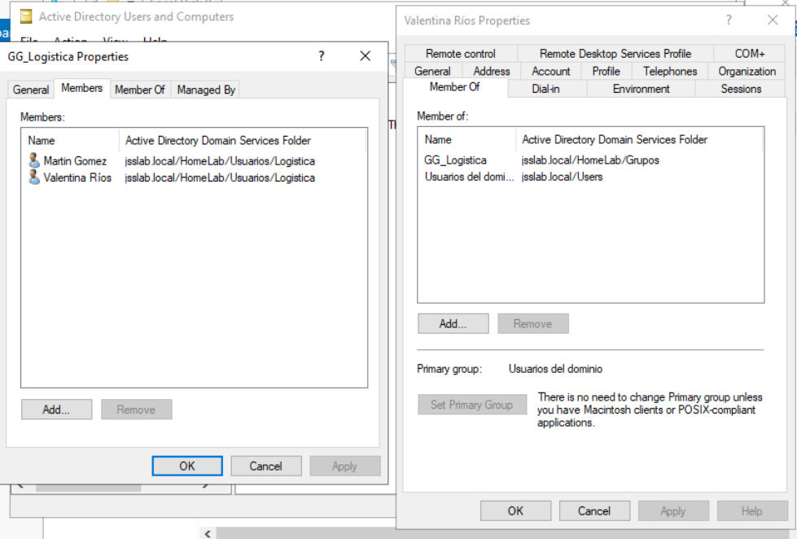
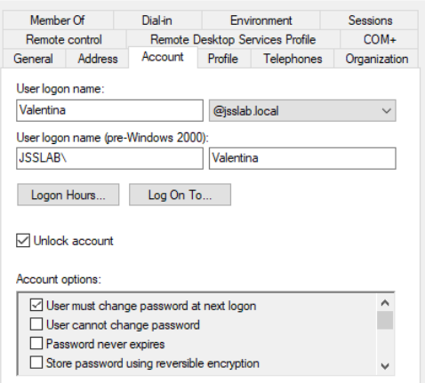
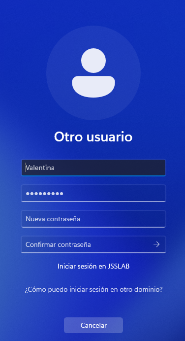
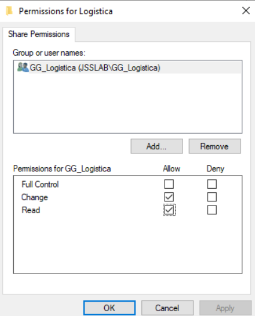

# Caso 02: Alta de nuevo empleado

**Tipo:** Solicitud de servicio | **Prioridad:** Media

## Resumen
La responsable de Logística solicita el alta de una nueva integrante de su equipo.
Se crea la cuenta en la OU del departamento, se asigna a los grupos de acceso
correspondientes y se verifica que el usuario pueda iniciar sesión y acceder solo
a los recursos que le corresponden.

## Requerimiento recibido
La jefa del área envió el pedido con los datos del nuevo empleado:

- **Nombre:** Valentina Ríos
- **Puesto:** Analista de Logística
- **Fecha de ingreso:** [16/11/2026]
- **Accesos:** carpeta compartida de Logística
- **Equipamiento:** [notebook estándar / ya asignado]
- **Aprobación:** [la da la responsable del área]

## Validación del pedido
Verifiqué que el ticket incluyera los datos necesarios y que la solicitud estuviera aprobada por la responsable del área.

## Solución
1. Creé la cuenta en Active Directory, dentro de la OU `Usuarios/Logistica`.
2. Agregué la cuenta al grupo `GG_Logistica`. Los permisos se dan por grupo y no a la persona directamente.
3. Generé una contraseña temporal con la opción de cambio obligatorio en el primer
   inicio de sesión.
4. Comuniqué la contraseña temporal por el canal interno, nunca por el ticket.

## Resultado
Probé el primer inicio de sesión desde la VM cliente: el sistema pidió cambiar la
contraseña y el acceso funcionó. Verifiqué que el usuario puede abrir la carpeta de
Logística. El ticket se cerró con resolución **Done**.

## Aprendizaje
- El alta la solicita el responsable del área y no el propio empleado, y conviene
  contar con su aprobación antes de crear la cuenta.
- Asignar permisos por grupos facilita los cambios futuros: si la persona cambia de
  área, solo se modifica su pertenencia a grupos.
