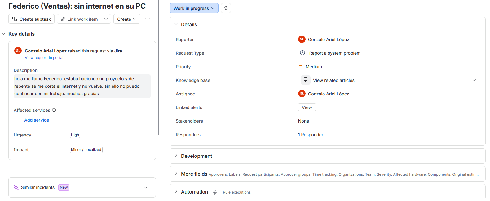
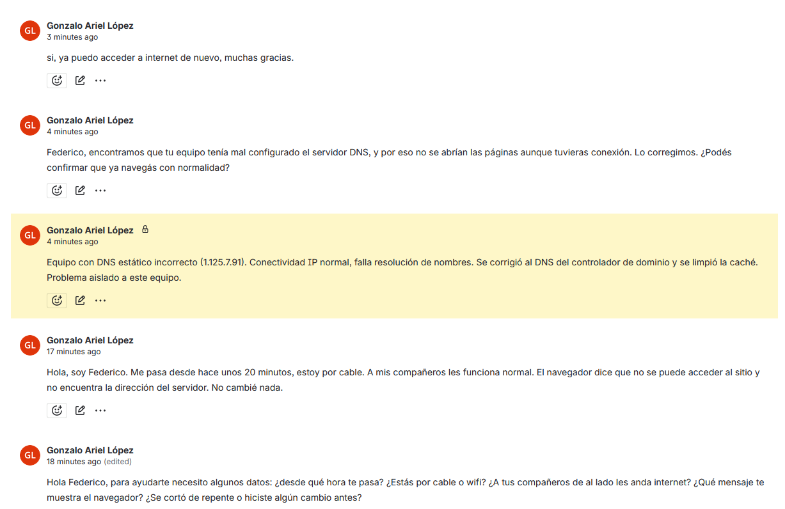
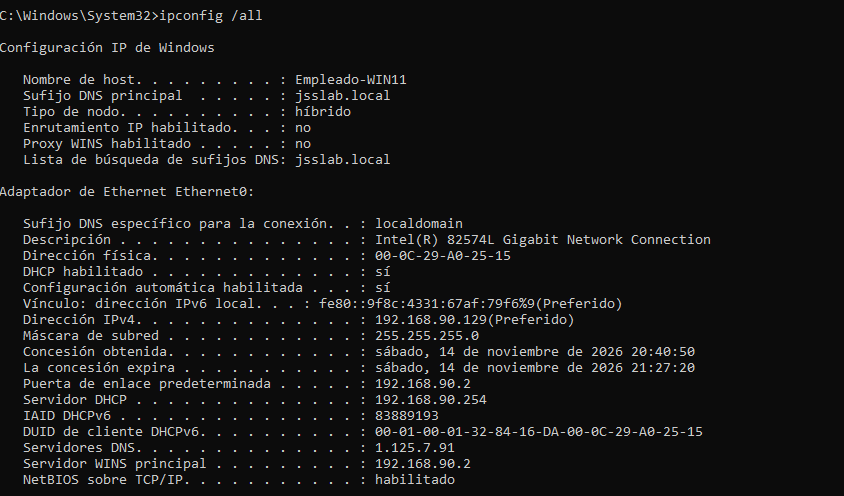
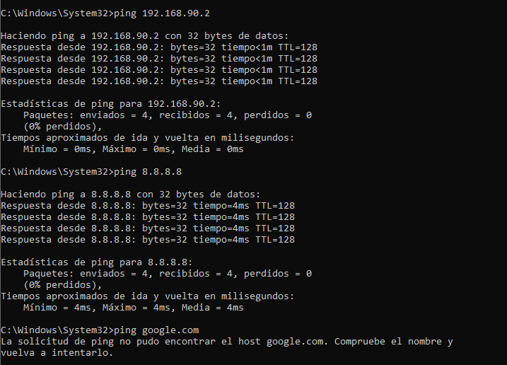
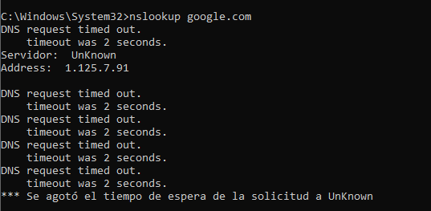
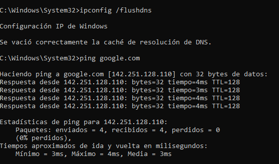

# Caso 03: Usuario sin acceso a internet

**Tipo:** Incidente | **Prioridad:** Media (Urgencia Alta, Impacto Menor/Localizado) | **Herramientas:** Jira Service Management, herramientas de diagnóstico de red (CMD)

## Resumen
Un usuario reporta que perdió el acceso a internet en su equipo. Tras descartar que fuera
un problema general de red, el diagnóstico por capas muestra que el equipo tenía conectividad
pero un servidor DNS mal configurado, lo que impedía resolver nombres. Se corrigió la
configuración y se verificó la navegación.

## Problema reportado
El usuario escribió: "Estaba haciendo un proyecto y de repente se me corta el internet
y no vuelve."

## Información solicitada al usuario
Pedí más datos con un comentario público: desde cuándo ocurre, si usa cable o wifi, si a
sus compañeros les pasa lo mismo y qué mensaje muestra el navegador.

El usuario respondió que ocurre desde hace unos 20 minutos, que está por cable, que a sus
compañeros les funciona normal y que el navegador no encuentra la dirección del servidor.

Con esto descarté una falla general de red: el problema es **local a su equipo**, lo que
coincide con el impacto Menor/Localizado del ticket.

## Diagnóstico
Me conecté al equipo del usuario y probé de lo más cercano a lo más lejano:

| Paso | Comando | Resultado | Conclusión |
|------|---------|-----------|------------|
| 1 | `ipconfig /all` | IP y puerta de enlace correctas; DNS configurado: `1.125.7.91` | El DNS no es el del dominio |
| 2 | `ping [192.168.90.2]` | Responde | Llega al gateway |
| 3 | `ping 8.8.8.8` | Responde | Hay salida a internet por IP |
| 4 | `ping google.com` | Falla | No resuelve nombres |
| 5 | `nslookup google.com` | Error: tiempo de espera agotado | El servidor DNS configurado no responde |

**Conclusión:** hay conectividad de red, pero falla la resolución de nombres porque el
equipo tiene configurado un servidor DNS incorrecto.

## Solución
1. Abrí las propiedades IPv4 del adaptador de red.
2. Reemplacé el DNS incorrecto por la IP del controlador de dominio.
3. Limpié la caché de DNS con `ipconfig /flushdns`.
 

## Resultado
Verifiqué que `ping google.com` respondiera y que el navegador cargara páginas con
normalidad. Pedí confirmación al usuario antes de cerrar. El ticket se cerró con
resolución **Done**.

## Aprendizaje
- Hacer preguntas al inicio permite distinguir un problema local de uno general.
- Que un `ping` por IP funcione y por nombre falle apunta directo a DNS.
- En un equipo del dominio, el DNS debe ser el del controlador de dominio