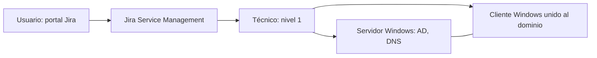
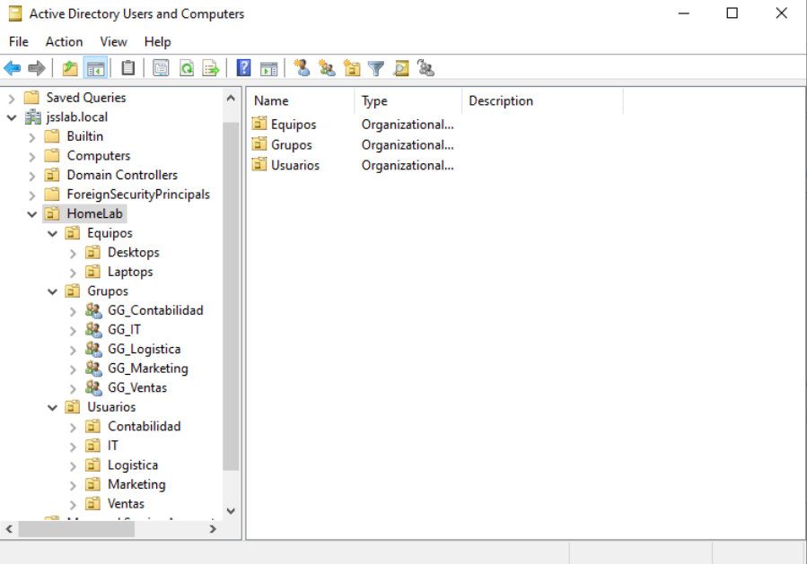

# Home Lab de Soporte IT

Simulación de una mesa de ayuda con Active Directory y Jira Service Management, armada
para practicar soporte técnico nivel 1. Cada caso documenta el pedido del usuario, el
diagnóstico, la solución y lo aprendido, siguiendo el flujo de un ticket real.

## Objetivo
Practicar el trabajo diario de un técnico de soporte: atender solicitudes, diagnosticar
incidentes, administrar cuentas y permisos.

## Entorno

| Componente | Detalle |
|------------|---------|
| Virtualización | VMware Workstation |
| Servidor | Windows Server 2022: Active Directory, DNS |
| Cliente | Windows 10/11 unido al dominio |
| Gestión de tickets | Jira Service Management (nube) |
| Dominio | [jsslab.local] |

## Arquitectura



[Opcional: reemplazá el diagrama con una imagen propia en `img/arquitectura.png`.]

## Estructura de Active Directory

```
[jsslab.local]
└── Homelab
    ├── Equipos
    │   ├── Desktops
    │   └── Laptops
    ├── Usuarios
    │   ├── Contabilidad
    │   ├── Ventas
    │   ├── Logistica
    │   ├── Marketing
    │   └── IT
    └── Grupos
        ├── GG_Contabilidad
        ├── GG_Ventas
        ├── GG_Logistica
        ├── GG_Marketing
        └── GG_IT
```

- **OU** para organizar cuentas y aplicar políticas.
- **Grupos** para asignar permisos: los accesos se dan a grupos y no a personas sueltas.
- **Convención de nombres:** `GG_` para grupos de departamento.



## Cómo trabajo cada ticket
1. Leo el pedido y pido la información que falta.
2. Verifico la identidad o la autorización cuando corresponde.
3. Diagnostico y resuelvo.
4. Documento lo hecho en una nota interna.
5. Cierro con un comentario claro al usuario y la resolución correspondiente.

La contraseña de un usuario nunca se escribe en el ticket.

## Casos documentados

| # | Caso | Tipo | Qué demuestra |
|---|------|------|---------------|
| 01 | [Cuenta bloqueada y reseteo de contraseña](01-cuenta-bloqueada/) | Incidente | Diagnóstico, verificación de identidad, administración de cuentas en AD |
| 02 | [Alta de nuevo empleado](02-alta-usuario/) | Solicitud | OU, grupos, permisos y comunicación con el solicitante |
| 03 | [Usuario sin acceso a internet](03-sin-internet/) | Incidente | Troubleshooting de red por capas (ipconfig, ping, nslookup) |

## Habilidades que practiqué
- **Active Directory:** usuarios, OU, grupos, bloqueo y desbloqueo de cuentas, reseteo de contraseñas
- **Redes básicas:** diagnóstico con `ipconfig`, `ping`, `nslookup`, DNS
- **Gestión de tickets:** Jira Service Management, prioridades, estados, resolución, notas internas
- **Comunicación con el usuario:** preguntas claras, comentarios de cierre, escalamiento
- [Agregá solo lo que realmente hiciste, por ejemplo Microsoft 365 o GPOs.]


## Sobre mí
Estudiante de Ingeniería Informática (UBA), cursando , con certificado de
Google IT Support. Busco mi primera experiencia en soporte técnico nivel 1.

- **LinkedIn:** [www.linkedin.com/in/gonzalo-lópez-023a05376]
- **Contacto:** [lopezgonzaloariel1@gmail.com]

> Todos los nombres de usuarios, empresas y datos de este repositorio son ficticios
> y pertenecen a un entorno de laboratorio.